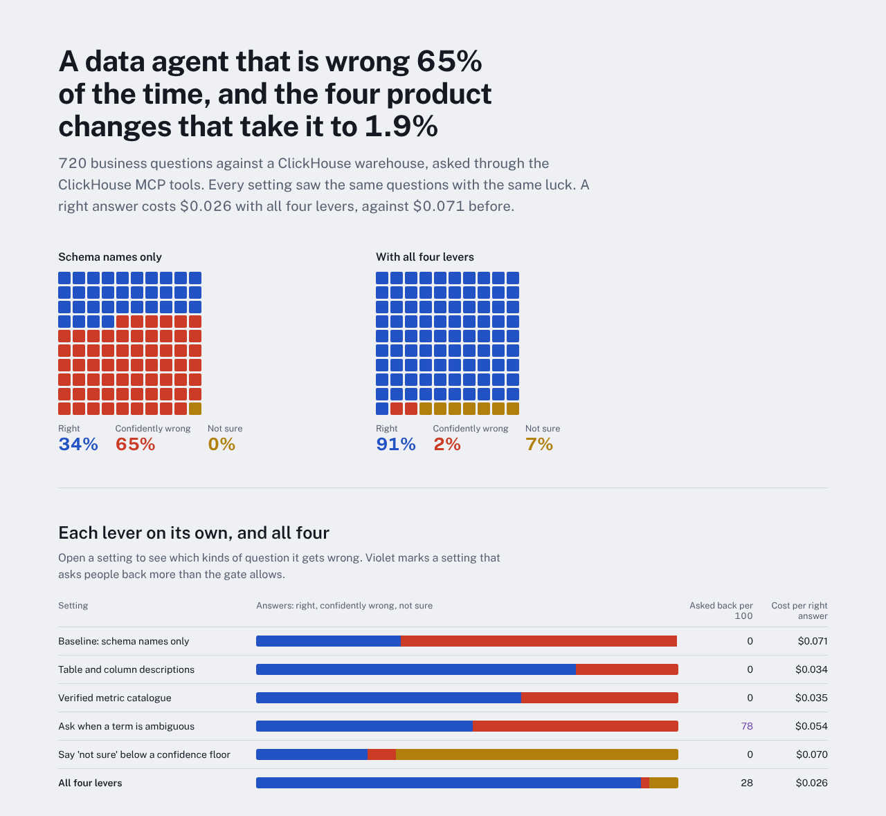

# analytics-agent-levers

Which product changes make a data agent right more often, cheaper and more trusted?

An agent answers business questions from a ClickHouse warehouse through the tools of the ClickHouse MCP server. Four
product levers are measured on the same questions with the same luck, each against a launch gate:

- **table and column descriptions**, written into ClickHouse as COMMENTs so every MCP client sees them
- **a verified metric catalogue**, a `get_metric` tool with the data team's definitions
- **one clarifying question** when a term or an account name is ambiguous
- **"not sure"** below a confidence floor

Every run is written as Langfuse ingestion events: traces, generations with token usage and cost, tool spans, and the
verdict as a score. The product decision is in [docs/brief.md](docs/brief.md).



**What is real and what is not.** The warehouse is real ClickHouse (chDB, embedded): 11 tables and about 1.4 million
rows, including the traps real warehouses have (a deprecated invoice table, retried payments, a half-finished backfill,
near-duplicate account names). Every query the agent writes runs against it, and answers are judged on result sets.
The agent's *choices* come from a seeded stand-in for a language model, because no model API was available here (see
[docs/decisions.md](docs/decisions.md)). `ClaudePlanner` runs the same loop on the Anthropic API and is tested against a
scripted API, but it was not run for these numbers.

## Results

<!-- results:start -->
720 questions (240 per seed, seeds 11, 23, 37) against a ClickHouse warehouse of 11 tables, every setting on the same questions with the same luck. Answers are judged on their result sets.

**Each lever, and all four together**

| Setting | Correct | Confidently wrong | Not sure | Questions asked per 100 | Cost per question | Cost per correct answer | p95 time |
|---|---:|---:|---:|---:|---:|---:|---:|
| Baseline: schema names only | 34.3% | 65.4% | 0.0% | 0 | $0.0245 | $0.0714 | 19.5 s |
| Table and column descriptions | 75.7% | 24.3% | 0.0% | 0 | $0.0257 | $0.0339 | 14.3 s |
| Verified metric catalogue | 62.8% | 37.2% | 0.0% | 0 | $0.0221 | $0.0352 | 16.9 s |
| Ask when a term is ambiguous | 51.4% | 48.6% | 0.0% | 78 | $0.0277 | $0.0539 | 19.5 s |
| Say 'not sure' below a confidence floor | 26.4% | 6.7% | 66.9% | 0 | $0.0186 | $0.0705 | 11.7 s |
| All four levers | 91.1% | 1.9% | 6.9% | 28 | $0.0233 | $0.0255 | 16.9 s |

**Launch gate** (`config/platform.toml [gate]`)

| Lever, against the baseline | Correctness gain (95% interval) | Change in confidently wrong | Asked per 100 | Decision |
|---|---:|---:|---:|---|
| Table and column descriptions | +41.4% (+37.6% to +45.0%) | -41.1% | 0 | ship |
| Verified metric catalogue | +28.5% (+25.0% to +31.7%) | -28.2% | 0 | ship |
| Ask when a term is ambiguous | +17.1% (+14.3% to +20.0%) | -16.8% | 78 | hold: clarifying questions per 100 questions |
| Say 'not sure' below a confidence floor | -7.9% (-11.8% to -3.9%) | -58.8% | 0 | hold: correctness gain, lower end of the 95% interval |
| All four levers | +56.8% (+52.9% to +60.6%) | -63.5% | 28 | ship |

**What each lever adds when the other three are already on** (the order to ship them)

| Lever | Correctness it adds on top of the other three | Change in confidently wrong |
|---|---:|---:|
| Table and column descriptions | +19.3% (+16.5% to +22.5%) | -5.8% |
| Say 'not sure' below a confidence floor | +6.9% (+4.2% to +9.6%) | -13.9% |
| Ask when a term is ambiguous | +6.0% (+4.3% to +7.8%) | +0.0% |
| Verified metric catalogue | +3.9% (+2.5% to +5.3%) | +0.0% |

**Where the errors were**

| Question kind | Baseline correct | All levers correct | All levers: not sure |
|---|---:|---:|---:|
| Clear questions (407 questions) | 44% | 86% | 11% |
| Company-defined words ("revenue") (193 questions) | 30% | 98% | 0% |
| Account named by two words (42 questions) | 24% | 88% | 12% |
| Data we do not have (78 questions) | 0% | 100% | 0% |

**Held-out company** (`config/world_heldout.toml`, run once on 2026-11-12): other data, more ambiguous questions, and words nobody tuned for ("turnover", "engaged customers")

| Setting | Correct | Confidently wrong | Not sure | Questions asked per 100 | Cost per question | Cost per correct answer | p95 time |
|---|---:|---:|---:|---:|---:|---:|---:|
| Baseline: schema names only | 30.0% | 70.0% | 0.0% | 0 | $0.0244 | $0.0815 | 19.5 s |
| Table and column descriptions | 62.1% | 37.9% | 0.0% | 0 | $0.0262 | $0.0422 | 14.3 s |
| Verified metric catalogue | 53.3% | 46.7% | 0.0% | 0 | $0.0238 | $0.0445 | 16.9 s |
| Ask when a term is ambiguous | 48.3% | 51.7% | 0.0% | 80 | $0.0278 | $0.0574 | 16.9 s |
| Say 'not sure' below a confidence floor | 25.0% | 5.4% | 69.6% | 0 | $0.0188 | $0.0751 | 11.7 s |
| All four levers | 78.8% | 0.4% | 20.8% | 36 | $0.0246 | $0.0312 | 16.9 s |

| Question kind | Baseline correct | All levers correct | All levers: not sure |
|---|---:|---:|---:|
| Clear questions (118 questions) | 48% | 81% | 19% |
| Company-defined words ("revenue") (90 questions) | 17% | 69% | 30% |
| Account named by two words (6 questions) | 0% | 83% | 17% |
| Data we do not have (26 questions) | 0% | 100% | 0% |

Traces: `reports/traces_sample.jsonl` holds 246 Langfuse ingestion events (traces, generations with token usage and cost, tool spans, and the verdict as a score); `python scripts/traces.py --send` posts them to a Langfuse project.
<!-- results:end -->

## How it fits together

```
 question ──► agent loop (src/alv/agent/loop.py) ──► planner: stand-in policy  or  ClaudePlanner (Messages API, tool use)
                 │  tokens, cost and time per turn            │
                 ▼                                            ▼
           tools (src/alv/tools.py) = ClickHouse MCP tools + levers   ◄── also served over stdio: python -m alv.mcp_server
           list_tables · describe_table · run_select_query (read-only) · get_metric (catalogue) · ask the person
                 │
                 ▼
           ClickHouse warehouse (chDB) ── COMMENTs = the descriptions lever

 evaluation: same questions, same luck ─► judged on result sets ─► paired 95% intervals ─► launch gate
 traces: Langfuse ingestion events (trace, generation, span, score) ─► reports/traces_sample.jsonl or a Langfuse project
```

## Run it

```bash
pip install -e ".[dev]"
pytest -q                          # 22 tests, about 10 s
python scripts/evaluate.py         # every lever setting, 720 questions, about 40 s
python scripts/report.py           # README results and the dashboard's data
python -m alv.mcp_server --levers descriptions,metric_catalog   # the tools for any MCP client
cd web && npm ci && npm run dev    # the dashboard
```

## Layout

| Path | What it is |
|---|---|
| `src/alv/agent/loop.py` | The agent loop and its accounting |
| `src/alv/agent/claude.py` | The planner on the Anthropic Messages API |
| `src/alv/tools.py` | ClickHouse MCP tools, read-only, plus the levers |
| `src/alv/mcp_server.py` | The tools as an MCP server over stdio |
| `src/alv/trace.py` | Langfuse ingestion events and the sender |
| `src/alv/sim/` | The stand-in model and the person who answers clarifying questions |
| `src/alv/world/` | The warehouse and the questions with their truth |
| `src/alv/evals/` | Scoring, paired intervals, the gate, what each lever adds |
| `config/` | Prices, levers, metric definitions, descriptions, the gate; the tuning and held-out worlds |
| `docs/brief.md` | The product brief: what to ship, in what order, how to price it |
